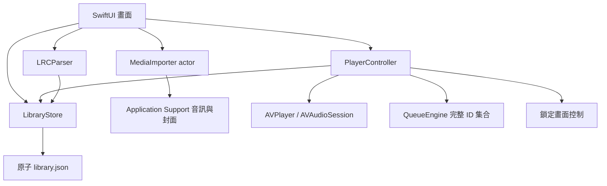

# 架構與設計

UI、服務與純資料邏輯分開。核心模型只有 Foundation 依賴，可在 macOS 直接跑 Swift Package 測試。媒體匯入 actor 非同步讀取音訊軌與中繼資料，複製到應用程式自己控制的資料夾。畫面沒有假資料。

QueueState 保存 sourceIDs 完整集合、order 本輪順序、index 已消耗游標、pending 手動插隊、history 已播歷史、currentID、進度、循環與歌單來源。Swift 標準庫均勻 shuffle 對完整去重 ID 集合操作。下一輪循環才重建 order；手動插隊視為使用者的額外指定播放，可以重複，與自動洗牌不重複保證區分。

播放進度是唯一歌詞時間軸，偏移只改顯示時間；seek 不重設業務歌曲。聆聽秒數以播放器實際前進量限制於經過時間，停頓與跳轉不算聆聽。事件含來源歌單及 duration，用於完成比例；抵達尾端與完整聽完不是相同概念。

資料庫採單一版本化 JSON 快照，以 atomic write 替換；讀取毀損或未知版本即禁止覆寫。每十秒及播放／佇列／生命週期變更保存。首版以數百至數千首為設計範圍，尚未做大型資料庫效能驗證。

視覺採深綠、茶金與低干擾暗色背景，封面與曲目資訊為重心。沒有外部授權素材時使用原創符號與漸層，不下載動態封面。採原生 NavigationStack、List、表單與無障礙文字。

MusicSourceProvider／StreamCandidate 保留來源與錄音對齊資訊。首版僅本機來源，QualityUpgradeState 只能表達未支援，不假裝已實作無縫升級。
