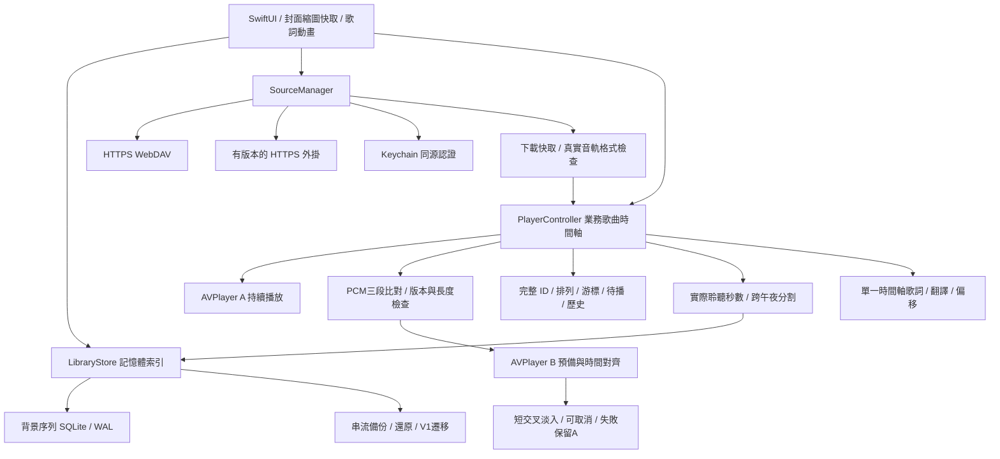

# V2 架構與時間軸

SourceVariant 代表某錄音的一個來源，不把相同歌名視為相同錄音。manifest 的品質只供候選排序，顯示及升級判斷使用下載後 AVFoundation 可讀到的音軌資訊。未知格式欄位保留未知，estimatedDataRate 標記估計。

遠端來源完整下載到本機快取才進播放器。這讓私人認證、音檔解碼與雙版本比對可控，代價是初次點播大型音檔有等待時間；不宣稱大型遠端 FLAC 可瞬間起播。

來源 B 在 A 持續播放時下載、解碼三段探針並做互相關；時間差、相關性、錄音識別或時鐘不合格即拒絕。播放器用 generation 與取消狀態防止下一首、seek、停止、還原資料後舊候選回寫。切換更新底層音源，但不建立新業務歌曲或重設統計事件。

音量匹配只在 AVPlayer 可提供的衰減範圍內；這是有門檻的近連續切換，不是樣本級混音引擎、bit-perfect 輸出或母帶等價證明。完整解碼與真實雙播放器行為需要 Apple 平台驗證。

LibraryStore 發布記憶體快照與穩定 ID 索引，SQLite worker 合併短期寫入並在 transaction 更新異動列。備份還原先驗證、暫存，再替換索引；保留還原前資料庫。沒有把完整索引綁在 UI 分頁。

SwiftUI 視覺採茶金、深綠、封面色彩背景與原生可及性基礎。圖片以背景縮圖與快取供給畫面；減少動態效果與節電限制動畫。歌詞用播放時間驅動遮罩進度，滑動瀏覽可暫停跟隨。
